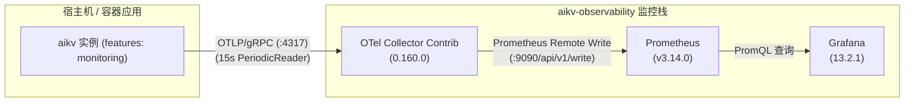

# AiKv 可观测性监控栈 (Observability Stack)

本目录提供面向 `aikv` 存储引擎与协议层的轻量级, 免维护, 安全默认的可观测性监控栈. 内置 OpenTelemetry Collector, Prometheus 和 Grafana 三件套, 自动挂载预置数据源与五张看板: 总览, 排障, 容量, 集群, 连接.

---

## 1. 架构总览



---

## 2. 构建关键前提 (重要)

- **宿主机直接运行前提**:
  若在宿主机直接通过 `cargo run` 或 `target/debug/aikv` 启动, **必须显式开启 `monitoring` feature**:
  ```bash
  cargo build -p aikv --features monitoring
  ```
  > **注意**: 默认 feature 构建的 `aikv` 二进制**不会注册任何 OTel 指标**, 无法将白盒度量推送至 Collector.
- **容器镜像构建**:
  `deploy/Dockerfile` 与 `deploy/Dockerfile.local` 镜像构建脚本已默认启用 `--features cluster,monitoring,compression`, 容器镜像天然具备指标导出能力.

---

## 3. 快速上手

### 3.1 启动监控栈

```bash
cd deploy

# 方式 A: 单机全量启动 (默认拉起 Server 与本机探针)
./observability.sh up

# 方式 B: 多机解耦部署
# 监控机启动监控中心 (Prometheus + Grafana + OTel):
./observability.sh up --server
# 存储节点机启动探针 (Node Exporter + cAdvisor):
./observability.sh up --agent
```

脚本将自动检测 Docker/Compose 环境, 自 `deploy/.env.example` 复制默认环境变量, 启动服务并执行轮询探活.

- **Grafana 访问**: [http://127.0.0.1:3000](http://127.0.0.1:3000) (默认免密 Viewer 模式, 管理员账号 `admin` / `admin`)
- **Prometheus 访问**: [http://127.0.0.1:9090](http://127.0.0.1:9090)
- **OTel 收集端点**: 宿主机访问 `127.0.0.1:4317` (gRPC) / `127.0.0.1:4318` (HTTP); 同 Docker 网络容器原生 DNS 为 `http://aikv-otel-collector:4317`
- **平台自适应说明**: 监控栈支持自动感知平台环境. 在 Linux 下会自动加载 `cAdvisor` 容器采集精细化容器硬件指标; 在 macOS 或缺少 `/dev/kmsg` 设备的环境下会自动跳过 `cAdvisor`, 避免容器启动崩溃.

### 3.2 停止监控栈

```bash
# 停止容器并保留历史监控数据卷 (aikv-prom-data, aikv-grafana-data)
./observability.sh down [--all|--server|--agent]

# 停止容器并清空历史监控数据卷 (持久保留用户 targets/*.yaml 配置)
./observability.sh down --purge [--all|--server|--agent]
```

---

## 4. aikv 实例对接指南

启动 `aikv` 实例时, 只需设置标准 OpenTelemetry 环境变量 `OTEL_EXPORTER_OTLP_ENDPOINT`:

```bash
export OTEL_EXPORTER_OTLP_ENDPOINT=http://127.0.0.1:4317

# 启动示例
./target/debug/aikv --engine aidb --data-dir /tmp/aikv-data --bind 127.0.0.1:6379
```

指标按 15 秒周期 (OTel `PeriodicReader`) 自动批量推送至 Collector.

---

## 5. 指标语义规范与对账契约

完整度量规范, 计算公式与埋点定义详见底层文档: [`aidb/docs/metrics.md`](../../../aidb/docs/metrics.md).

在 Grafana 曲线与 Redis `INFO` 面板之间对账时, 遵循以下确定性契约:

| 观测维度 | Grafana PromQL 指标 | Redis INFO 对应字段 | 对账契约与口径 |
| :--- | :--- | :--- | :--- |
| **WAL 重放耗时** | `aidb_recovery_wal_replay_duration_seconds` | `INFO storage` -> `recovery_wal_replay_duration_us` | **OTel 秒 = INFO 微秒 × 10⁻⁶**; 受 Reset 白名单保护常驻 |
| **WAL 重放物理字节** | `aidb_recovery_wal_replayed_bytes` | `INFO storage` -> `recovery_wal_replayed_bytes` | 物理字节量 **1:1 等价** (Gauge 规范无 `_total` 后缀) |
| **Manifest 恢复耗时** | `aidb_recovery_manifest_duration_seconds` | `INFO storage` -> `recovery_manifest_duration_us` | **OTel 秒 = INFO 微秒 × 10⁻⁶**; 覆盖三大冷启动恢复分支 |
| **SST 打开耗时** | `aidb_recovery_sstable_open_duration_seconds` | `INFO storage` -> `recovery_sstable_open_duration_us` | **OTel 秒 = INFO 微秒 × 10⁻⁶**; 全量 SSTable 校验耗时 |
| **键计数器重扫耗时** | `aikv_recovery_rebuild_counters_duration_seconds` | `INFO storage` -> `recovery_rebuild_counters_duration_us` | **OTel 秒 = INFO 微秒 × 10⁻⁶**; 16 个 DB 全库键重建耗时 |
| **系统 OS 线程数** | `aikv_process_threads` | `INFO threads` -> `process_threads` | 操作系统当前真实线程数 **1:1 等价** |
| **上下文切换速率** | `aikv_process_context_switches_total` | `INFO threads` -> 差分累加 | 差分速率曲线对应 INFO 字段累加差分速率 |

---

## 6. 预置监控大盘

Grafana 启动后加载 `AiKv` 目录下的五张看板. 查询只使用已经导出的序列, 速率窗口是变量 `$rate_window`.

1. `aikv-overview` 总览: 命令速率, 错误比例, 不按命令拆开的延迟, 慢查询, 点查命中率, 连接与拒绝, L0 和写停顿.
2. `aikv-troubleshoot` 排障: MemTable, Block Cache, 各层 SST, WAL, flush 与 compaction 的字节速率和最近一次耗时, Bloom, 读放大, 以及按命令的 P99.
3. `aikv-capacity` 容量: 引擎条目估值, 本进程登记的 TTL, 过期键速率, SST 字节合计和 RSS.
4. `aikv-cluster` 集群: 每个 group 一行的角色和滞后. 只有启用 Raft 时使用. L0, MemTable 和本周期最大停顿是进程合计.
5. `aikv-connections` 连接: 网络入出字节, 按 errno 分开的 accept 错误, 按关闭原因分开的断开, 以及 SCAN 扫描量.

---

## 7. 已知客户端 Trace 拒收警告说明 (文档化预期行为)

默认采样率是 `0`, 进程不导出 span. 采样率大于 `0` 且配置了 OTLP 端点时, Collector 的 `traces` 流水线接收 span 并交给 `debug` exporter. 这不是 Tempo, 也不再把 status 12 (`Unimplemented`) 当成稳态.

---

## 8. OpenTelemetry 单位规范化与 Transform 策略 (架构决策)

- **现象与挑战**:
  OpenTelemetry Collector 0.160+ 默认开启了单位规范化 (Unit Normalization). 当 Instrument 以无量纲单位 `with_unit("1")` 注册时 (如 `aikv_process_threads`, `aidb_sstable_count`), Prometheus Remote Write Exporter 默认会将其视为 ratio 并追加 `_ratio` 后缀 (导致仪表盘指标名漂移查无数据).
- **全局选项 `add_metric_suffixes: false` 的副作用**:
  若在 Exporter 侧全局设置 `add_metric_suffixes: false`, 会连带禁用 Histogram 直方图指标的 `_bucket`, `_sum`, `_count` 类型后缀, 导致所有延迟分位数计算 (如 Write Stall P99, 命令耗时分布) 的底层时序完全缺失.
- **最佳解法: Transform Processor**:
  在 Collector 管道中引入 `transform/strip_unit_one` 处理器:
  ```yaml
  processors:
    transform/strip_unit_one:
      metric_statements:
        - context: metric
          statements:
            - set(unit, "") where unit == "1"
  ```
  在导出前自动将无量纲 `unit="1"` 清空, 既避免跨仓修改底层存储引擎代码, 又同时实现了:
  1. Gauge 指标绝不产生 `_ratio` 后缀漂移;
  2. Histogram 直方图派生序列 (`_bucket`, `_sum`, `_count`) 100% 完整保留.
