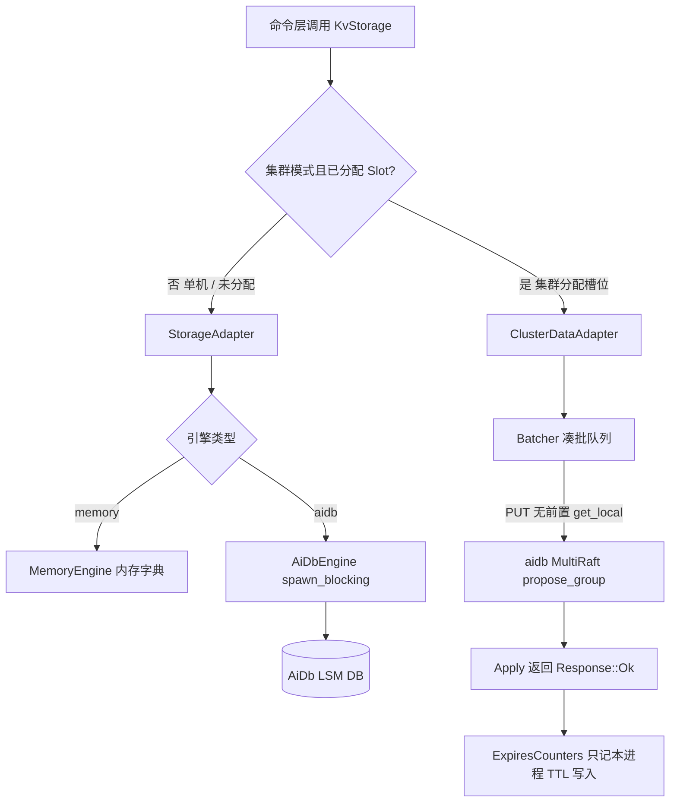

# AiKv Storage (存储适配层)

## 何时读本文

- 修改 `src/storage/{adapter.rs, adapter/collection_ops.rs, cluster_adapter.rs, cluster_batcher.rs, aidb.rs, memory.rs, collection.rs, subkey.rs, compaction_filter.rs, dump.rs, types.rs, watch_version.rs, watch_registry.rs, mod.rs}` 源码;
- 排查 `KvStorage` 接口行为、内存引擎 (`MemoryEngine`) 与持久化引擎 (`AiDbEngine`) 路径差异;
- 排查大集合 (Hash/Set) 版本化 subkey 布局、暂存写、compaction GC 与 TTL 惰性过期机制、DUMP/RESTORE 编解码;
- 排查集群模式下数据面写操作的 MultiRaft 批处理 (`ClusterDataAdapter` / `propose_group`);
- **不覆盖**: 底层 LSM 存储引擎 (WAL/MemTable/SSTable/Compaction) → [AiDb Engine 文档](https://github.com/wiqun/AiDb/blob/main/docs/modules/01-engine.md);
- **不覆盖**: MetaRaft 控制面拓扑与 Slot 迁移状态机 → [AiDb Cluster 文档](https://github.com/wiqun/AiDb/blob/main/docs/modules/03-cluster.md);
- **不覆盖**: 集群 MOVED/ASK 重定向与 CLUSTER 命令 → [cluster.md](06-cluster.md);
- **不覆盖**: 命令具体业务实现 → [commands-core.md](04-commands-core.md).

---

## 代码地图

| 文件路径 | 模块核心职责 | 公共接口与核心入口 |
| :--- | :--- | :--- |
| [`src/storage/mod.rs`](../../src/storage/mod.rs) | 存储模块根; 统一 re-export 核心 Trait、引擎实现与辅助类型 | `KvStorage`, `StorageAdapter`, `AiDbEngine`, `MemoryEngine` |
| [`src/storage/adapter.rs`](../../src/storage/adapter.rs) | `KvStorageAdapter` Trait 定义与通用的存储层统一调度适配器 | `StorageAdapter`, `AdapterWriteOp` |
| [`src/storage/types.rs`](../../src/storage/types.rs) | 核心存储 Trait (`KvStorage`)、`StoredValue`、`ValueType` 与 `WriteOp` | `KvStorage`, `StoredValue`, `ValueType`, `WriteOp` |
| [`src/storage/memory.rs`](../../src/storage/memory.rs) | 纯内存存储实现 (16 个独立 DB 容器, 用于开发与单元测试) | `MemoryEngine` |
| [`src/storage/aidb.rs`](../../src/storage/aidb.rs) | AiDb LSM 同步存储引擎适配 (基于 `spawn_blocking` 桥接 Tokio) | `AiDbEngine` |
| [`src/storage/aidb_options.rs`](../../src/storage/aidb_options.rs) | LSM 存储参数预设映射 (`default`, `high-write`, `high-read`) | `server_db_options_with_preset`, `DbPreset` |
| [`src/storage/cluster_adapter.rs`](../../src/storage/cluster_adapter.rs) | 集群数据面存储适配器: 槽位判断、写批处理 (`Batcher`) 与 Raft propose | `ClusterDataAdapter` (feature = "cluster") |
| [`src/storage/watch_registry.rs`](../../src/storage/watch_registry.rs) | 本节点 WATCH 引用计数; 无人 watch 时跳过 meta 写 | `WatchRegistry` |
| [`src/storage/watch_version.rs`](../../src/storage/watch_version.rs) | WATCH 版本 meta key 编码 (`{hash_tag}` 前缀保证同 slot) | `meta_user_key`, `is_watch_meta_user_key` |
| [`src/storage/subkey.rs`](../../src/storage/subkey.rs) | 大集合 (Hash/Set/ZSet) 版本化 subkey 物理键编解码、ZSET 分数序编码与分数区间键界、集群路由 user key 解析 | `encode_subkey`, `subkey_version_prefix`, `decode_versioned_subkey`, `routing_user_key`, `sortable_score`, `ScoreSpan`, `zset_score_range_keys` |
| [`src/storage/collection.rs`](../../src/storage/collection.rs) | 集合内联阈值、版本号生成、暂存写与 GC 宽限期常量; 集合提交结构; ZSET 成员级增量 `ZSetDelta` | `HASH_MAX_INLINE_FIELDS`, `SET_MAX_INLINE_MEMBERS`, `ZSET_MAX_INLINE_MEMBERS`, `ZSET_DEMOTE_MEMBERS`, `SUBKEY_GC_GRACE_US`, `CollectionWrite`, `HeaderWrite`, `ZSetDelta` |
| [`src/storage/adapter/collection_ops.rs`](../../src/storage/adapter/collection_ops.rs) | 集合 subkey 读写、分批暂存写、`RENAME`/`MOVE`/`SWAPDB` 的集合迁移实现 | `commit_collection_impl`, `put_value_impl`, `get_expanded_impl`, `move_key_impl`, `swap_db_impl` |
| [`src/storage/dump.rs`](../../src/storage/dump.rs) | `DUMP` / `RESTORE` 紧凑 postcard 序列化与版本校验 | `dump_encode`, `dump_decode`, `DUMP_VERSION` |
| [`src/command/zset/layout.rs`](../../src/command/zset/layout.rs) | ZSET 子键布局的命令路径: ZADD/ZREM/ZSCORE/ZCARD/ZINCRBY/ZPOPMIN/ZPOPMAX 与分数区间读取 (不展开整表) | `ZSetCommands::zadd`, `zrem`, `zincrby_subkey`, `pop_subkey`, `range_subkey` |
| [`src/command/script/transaction/zset_view.rs`](../../src/command/script/transaction/zset_view.rs) | 脚本内 ZSET 视图: 存储 `Z`/`R` 与本次 `ZSetDelta` 有序合并 (区间读、名次、ZADD/ZREM 增量) | `zset_view::range`, `zset_view::rank_of`, `zset_view::add`, `zset_view::remove` |
| [`src/storage/compaction_filter.rs`](../../src/storage/compaction_filter.rs) | compaction 时回收已过期主键与孤儿 subkey (单机/集群两种模式), 不改 `expires` | `AikvCompactionFilter` |
| [`src/storage/observation.rs`](../../src/storage/observation.rs) | 存储层点查、批写与扫描延迟与吞吐监控统计 | `StorageObservation` |

---

## 关键 Invariants (勿破坏规则)

- **`KvStorage` 抽象隔离**: 上层命令处理器仅持有 `Arc<dyn KvStorage>`, 禁止直接向下转型获取具体引擎实例.
- **单 `DB` 与多库隔离**:
  - 底层 AiDb 为单实例, 采用 `{db_index}:{user_key}` 前缀区分 Redis 0~15 号逻辑数据库;
  - `MemoryEngine` 在内部维护 16 个独立内存 Map, 两者上层 API 表现完全一致.
- **Subkey 编码隔离** (详见 §3):
  - 集合 header 键: `{db}:{user_key}`, 值为 `CollectionHeader { kind, count, version }`;
  - subkey 键: `{db}\x01{user_key_len}{user_key}{version}{tag}{sub}`, 与主键空间 `{db}:` 不共享前缀, KEYS/SCAN 只扫主键空间;
  - 删除集合只删 header (O(1)), 旧版本 subkey 变为垃圾, 由 compaction 回收 (宽限期内保留, 见 §3.3, §3.5);
  - 读取只可见版本与 header 相同的 subkey.
- **集群写必须走 Raft (`ClusterDataAdapter`)**:
  - 当集群已初始化且 Key 属于已分配 Slot 时, 写操作**必须**经过 `propose_group` 提交 MultiRaft, **严禁**绕过 Raft 回退本地写 (避免 SET 成功后读 Raft 为空);
  - 仅在单机模式或 Slot 未分配时写入本地存储.
- **Batcher 批处理参数常量**:
  - `SET_BATCH_MAX_OPS = 512`: 单批次最大聚合操作数;
  - `SET_BATCH_MAX_DELAY = 1ms`: 凑批等待时间上限;
  - `DEFAULT_EAGER_FLUSH = 48`: 达到该阈值时无需等待 1ms, 立即触发异步 Propose.
- **Leader 专有惰性删除**:
  - 读路径发现过期 Key 时, 仅当本节点是该 Key 所在 Data Group 的 Raft Leader 时才执行物理删除;
  - 只读副本 (`READONLY`) 发现过期 Key 仅在内存中返回 Nil, 不触发跨节点写入.
- **expires 与条目估值**:
  - `ExpiresCounters` 按逻辑 DB 记本进程成功写入 `expires_at = Some` 的次数. 覆盖写再加 1. 这次调用已经看到旧 TTL, 或惰性过期删掉带 TTL 的值时饱和减. compaction 不改它. 重启从 0 开始, `open` 不扫库.
  - `AiDbEngine::set` / `apply_writes` / `write_batch` 返回 `Result<()>`, 不为键计数做存在性判断. `exists` 仍走 `DB::key_exists`.
  - `DB::estimate_entry_count` 是 SST `num_entries` 与 MemTable `entry_count` 之和. 集群 `estimate_entry_count` 对本地 group 求和, 不调用 `scan_local_pairs`.
  - **集群写路径**: 数据写成功只接受 `Response::Ok`. DELETE Plain 仍前置一次 `get_local` 决定是否 propose. Batcher 按 key 做 last-write-wins reverse-dedup; 丢掉的中间 op ack 为 `false`, 实际提交的 op 在 `Ok` 后 ack `true`.
  - **WATCH meta 与用户写同一次 propose (Issue #83)**: 仅当 `WatchRegistry` 显示本节点有连接 WATCH 该 key 时, `set_typed` / `DEL` / `write_batch` 才把 user key 与 `{hash_tag}\xff\xff/aikv/watch/{user_key}` 送进同一 `put_many` / `apply_writes`.
  - `KvStorage::delete` 只用这一次已经发生的存在性读取决定返回的 bool, 再写入. 不再用 `apply_writes` 的 flag 做第二次判断.
  - `MemoryEngine` 的 `len` 校验 `db`, 返回全部逻辑 DB 上未过期, 非 watch meta 的用户 key 之和.

---

## 存储架构与批处理数据流



---

## 数据编码规则

### 1. `StoredValue` 内存与持久化结构

```rust
pub struct StoredValue {
    pub value_type: ValueType,
    pub expire_at: Option<u64>, // 绝对毫秒时间戳, None 表示永不过期
    pub data: Bytes,            // 二进制载荷
}
```

### 2. DUMP / RESTORE 内部格式

`DUMP` / `RESTORE` 使用内部格式 `[u8 version=1][postcard(StoredValue)]`, 非 Redis DUMP 兼容. 开发期无旧 `DUMP_VERSION=0` 载荷兼容义务.

### 3. 集合编码规范 (Hash / Set)

- **String / JSON / List**: 直接写入 `{db}:{key}` 作为完整 `StoredValue`; List 不走 subkey 布局 (见 §3.6). ZSet 见下方 ZSet 小节.
- **Hash / Set**: 按元素数量分两种形态, 阈值为 `HASH_MAX_INLINE_FIELDS = 64`, `SET_MAX_INLINE_MEMBERS = 64` (`src/storage/collection.rs`):
  - **内联**: 元素数不超过阈值时, 整个集合是 `{db}:{key}` 下的一个完整 `StoredValue`. `OBJECT ENCODING` 返回 `listpack`.
  - **subkey 布局**: 超过阈值后, `{db}:{key}` 只保存 `ValueType::CollectionHeader { kind, count, version }`, 元素散落为独立 subkey 键. `OBJECT ENCODING` 返回 `hashtable`.
  - 内联集合增长越过阈值时, 经 `put_value` 转为 subkey 布局 (分配新版本, 走暂存写).
- **ZSet**: 内联 `ValueType::ZSet` (成员数 ≤ `ZSET_MAX_INLINE_MEMBERS = 64`) 或 subkey 布局. 迟滞: 超过 64 转为子键; 子键成员数降到 ≤ `ZSET_DEMOTE_MEMBERS = 32` 时回落内联. 33..=64 之间保持原布局.
  - subkey 布局物理键: `Z` tag 为 `member → f64 BE 分数`, `R` tag 为 `sortable_score(score) || member` (空值). `R` 按分数字节序排列, 分数区间读取为一次前缀范围扫描 (`zset_score_range_keys`).
  - 写入增量: ZADD/ZREM/ZINCRBY/ZPOPMIN/ZPOPMAX 只提交变化的成员 (`Z`/`R` 增删) 与 header, 不整表重写; 脚本内同一 burst 的 ZSET 以 `ZSetDelta` 累积, 提交时展开为一次 `CollectionWrite`.

#### 3.1 物理布局

```text
header: {db}:{user_key}                                        值: postcard(StoredValue{CollectionHeader})
subkey: {db}\x01{user_key_len: u32 BE}{user_key}{version: u64 BE}{tag: u8}{sub}
        tag = 'H' (Hash, 值为 field 值) | 'S' (Set, 值为空)
```

- `\x01 < ':'`, `{db}\x01` 与 `{db}:` 不共享前缀: KEYS / SCAN / RANDOMKEY / INFO keyspace 只扫主键空间, 看不到 subkey.
- `user_key` 带长度前缀, 父 key 可以含任意字节; `sub` (field / member) 不带长度前缀, 不受 u16 限长约束.
- 同一集合同一版本的 subkey 在物理上连续, `subkey_scan` 是一次前缀扫描; HSCAN / SSCAN 与 HGETALL 等读路径只能看到 header 当前版本的 subkey.
- `FLUSHDB` / `FLUSHALL` 删除两个区间: `[{db}:, {db};)` 与 `[{db}\x01, {db}\x02)`.
- `DEL` / `UNLINK` / 惰性过期 / compaction TTL 只删除 header, O(1); 旧版本 subkey 成为垃圾, 由 §3.5 的 GC 回收.

#### 3.2 版本号与时钟风险

```text
version = max(last + 1, now_us << 11)
```

- 版本由进程内全局 `AtomicU64` 生成, 随 Raft entry 复制; 副本不自行生成. 低 11 位是同一微秒内的序号, 每微秒最多 2048 个版本.
- 仅在"新建 subkey 集合"时分配新版本: 内联转 subkey, `RENAME` / `COPY` / `MOVE` / `RESTORE` / `*STORE` / `SWAPDB` 写入的目标. 对已存在 header 的增删改沿用原版本.
- `version >> 11` 是版本生成的微秒时刻, 供 GC 宽限期使用.
- **时钟风险**: 进程重启或 leader 切换后, 若系统时钟回拨, 新版本可能小于旧版本. 只有新旧版本恰好相等时, 旧 subkey 才会重新可见, 需要回拨量与同一微秒内 2048 序号同时命中, 概率极低. **运维要求开启 NTP.**

#### 3.3 暂存写与 GC 宽限期

产生新版本的写入分两步:

1. 新版本 subkey 按每批 256 条 (`STAGE_CHUNK`) 分批 `apply_writes`, 每批等待完成. 此时 header 仍指向旧版本或不存在, 新 subkey 对读路径不可见.
2. 再一次 `apply_writes` 写入新 header (并删除源 header、更新 WATCH meta).

正确性只依赖顺序: 第 2 步开始前, 第 1 步的写已全部确认. 中途失败不会出现"半个集合"对外可见, 不需要事务. 步骤 1 残留的暂存 subkey 在宽限期后被回收.

已有 header 的集合改写 (`commit_collection`) 则在一次 `apply_writes` 中提交: subkey 的 put / delete 在前, header 与 WATCH meta 在后. 单机下这是一次原子提交.

**宽限期**: GC 对 `now_us - (version >> 11) < SUBKEY_GC_GRACE_US` (`SUBKEY_GC_GRACE_US = 3_600_000_000`, 即 1 小时) 的 subkey 一律保留, 无论其版本是否匹配. 1 小时同时覆盖副本时钟偏差与较长的暂存写时间.

#### 3.4 集群下 `apply_writes` 不是原子的

`ClusterDataAdapter::apply_writes` 把每个 op 单独送入所属 group 的批处理器 `GroupSetBatcher`, 批处理器按最多 512 条 (并与其它连接的写混合) 打包为 Raft entry. 因此一次 `apply_writes` 可能跨越多个 entry. 影响如下:

- **暂存写**: 只依赖顺序, 不受影响.
- **`commit_collection` (改已有集合)**: 若在两个 entry 之间崩溃或换主, 客户端会收到错误, 已写入的 subkey 可能可见而 `count` 未更新. 与 `apply_stored_batch` 同类问题, 当前未修复.
- **RENAME / COPY / MOVE**: 目标 header 写入与源 header 删除可能分属两个 entry. 中途失败时两个 key 可能同时存在, 各自指向自己的版本, 不丢数据.
- **SWAPDB (非原子)**: 两侧 subkey 先以新版本暂存到对侧, 再删除两个主键区间, 最后写入交换后的 header. "删区间 → 写回" 两步之间不原子: 若中途失败, 对应库可能暂时缺失交换后的数据. 与既有行为一致, 这是已知限制.

#### 3.5 GC: `AikvCompactionFilter`

`AikvCompactionFilter` (`src/storage/compaction_filter.rs`) 注册到 aidb 的 `DB::set_compaction_filter`:

- 单机: `AikvCompactionFilter::single_node()`, 物理 key 即 aikv key.
- 集群: `AikvCompactionFilter::cluster()`, 每个 group 是独立 DB, 数据面 key 带 `\x01sm/{gid 8B}/` 前缀; 其它前缀 (如 `\x00raft/`, `\x02mig/`) 一律保留, 不被当作 `StoredValue` 解码.

决策规则:

1. **主键** (能解码为 `StoredValue`): 已过期则删除, 否则保留.
2. **subkey**: 先看宽限期, 处于宽限期则保留; 否则点查 header `{db}:{user_key}`:
   - 读错误或解码失败 → 保留;
   - header 不存在 → 删除;
   - header 已过期 → 删除;
   - header 是 `CollectionHeader` 且版本相等 → 保留;
   - 其它 (版本不同或类型不同) → 删除.
3. **无 reader 的 `filter()`** 只执行第 1 步, subkey 一律保留. 带 reader 的 `filter_with_reader()` 由 aidb 在 compaction 中提供点查能力 (`CompactionPointReader`), 不得写入.

线程局部缓存: 同一集合的 subkey 在 compaction 中连续出现, 因此缓存最近一次 header 的观测结果 `Missing` / `Live(v)` / `Expired(v)`:

| 缓存结果 | 当前 subkey 版本 `s` | 决策 |
|------|------|------|
| `Live(v)` | `s == v` | 保留 |
| `Live(v)` 或 `Expired(v)` | `s < v` | 删除 |
| `Expired(v)` | `s == v` | 删除 |
| `Missing`, 或 `s > v` | — | 重新点查并更新缓存 |

正确性依据: 同一 key 的 header 版本只增不减 (受 §3.2 时钟风险约束), 过期 header 的版本不会再次生效 (过期后再写必然分配新版本). 因此缓存过时只会多保留, 不会误删.

**删除标记**: compaction 中若某 user key 的最新版本是 `Put` 且 filter 决定删除, 当存在快照或该 user key 落在仍存活的 SST 区间内时, aidb 写出 `TypeDelete` 删除标记而不是直接丢弃. 否则旧版本会在更低层复活. 该修复位于 aidb 侧, 见 aidb CHANGELOG.

#### 3.6 范围外

- List 扁平化不在本次范围. ZSET 已采用 subkey 布局 (2a 写路径, 2b 读路径与脚本视图); ZRANK / ZREVRANK / ZCOUNT 之外的 ZRANGEBYLEX / ZLEXCOUNT / ZSCAN / ZUNION / ZINTER / ZDIFF 仍经 `get_expanded` 展开整表 (O(N)), 留待后续.
- HSCAN / SSCAN 当前为全量加载后切片, 分页性能不在本次范围.
- 集群 slot 迁移: aidb 按物理 key 计算 slot, 不带 hash tag 时与 aikv 路由不一致, 既有问题, 单独记录.
