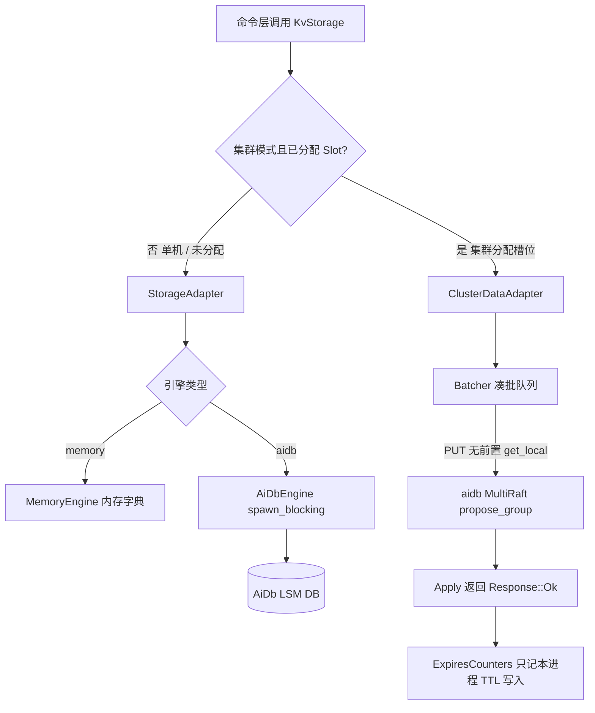

# AiKv Storage (存储适配层)

## 何时读本文

- 修改 `src/storage/{adapter.rs, cluster_adapter.rs, cluster_batcher.rs, aidb.rs, memory.rs, subkey.rs, dump.rs, ttl_filter.rs, types.rs, watch_version.rs, watch_registry.rs, mod.rs}` 源码;
- 排查 `KvStorage` 接口行为、内存引擎 (`MemoryEngine`) 与持久化引擎 (`AiDbEngine`) 路径差异;
- 排查 Subkey 扁平化编码、TTL 惰性过期机制、DUMP/RESTORE 编解码;
- 排查集群模式下数据面写操作的 MultiRaft 批处理 (`ClusterDataAdapter` / `propose_group`);
- **不覆盖**: 底层 LSM 存储引擎 (WAL/MemTable/SSTable/Compaction) → [AiDb Engine 文档](https://github.com/wiqun/AiDb/blob/main/docs/modules/01-engine.md);
- **不覆盖**: MetaRaft 控制面拓扑与 Slot 迁移状态机 → [AiDb Cluster 文档](https://github.com/wiqun/AiDb/blob/main/docs/modules/03-cluster.md);
- **不覆盖**: 集群 MOVED/ASK 重定向与 CLUSTER 命令 → [cluster.md](06-cluster.md);
- **不覆盖**: 命令具体业务实现 → [commands-core.md](04-commands-core.md).

---

## 代码地图

| 文件路径 | 模块核心职责 | 公共接口与核心入口 |
| :--- | :--- | :--- |
| [`src/storage/mod.rs`](../../src/storage/mod.rs) | 存储模块根; 统一 re-export 核心 Trait、引擎实现与辅助类型 | `KvStorage`, `StorageAdapter`, `AiDbEngine`, `MemoryEngine` |
| [`src/storage/adapter.rs`](../../src/storage/adapter.rs) | `KvStorageAdapter` Trait 定义与通用的存储层统一调度适配器 | `StorageAdapter`, `AdapterWriteOp` |
| [`src/storage/types.rs`](../../src/storage/types.rs) | 核心存储 Trait (`KvStorage`)、`StoredValue`、`ValueType` 与 `WriteOp` | `KvStorage`, `StoredValue`, `ValueType`, `WriteOp` |
| [`src/storage/memory.rs`](../../src/storage/memory.rs) | 纯内存存储实现 (16 个独立 DB 容器, 用于开发与单元测试) | `MemoryEngine` |
| [`src/storage/aidb.rs`](../../src/storage/aidb.rs) | AiDb LSM 同步存储引擎适配 (基于 `spawn_blocking` 桥接 Tokio) | `AiDbEngine` |
| [`src/storage/aidb_options.rs`](../../src/storage/aidb_options.rs) | LSM 存储参数预设映射 (`default`, `high-write`, `high-read`) | `server_db_options_with_preset`, `DbPreset` |
| [`src/storage/cluster_adapter.rs`](../../src/storage/cluster_adapter.rs) | 集群数据面存储适配器: 槽位判断、写批处理 (`Batcher`) 与 Raft propose | `ClusterDataAdapter` (feature = "cluster") |
| [`src/storage/watch_registry.rs`](../../src/storage/watch_registry.rs) | 本节点 WATCH 引用计数; 无人 watch 时跳过 meta 写 | `WatchRegistry` |
| [`src/storage/watch_version.rs`](../../src/storage/watch_version.rs) | WATCH 版本 meta key 编码 (`{hash_tag}` 前缀保证同 slot) | `meta_user_key`, `is_watch_meta_user_key` |
| [`src/storage/subkey.rs`](../../src/storage/subkey.rs) | 复杂数据结构 (Hash/List/Set/ZSet) 扁平化 Subkey 前缀编解码 | `encode_data_key`, `encode_meta_key`, `decode_key` |
| [`src/storage/dump.rs`](../../src/storage/dump.rs) | `DUMP` / `RESTORE` 紧凑 postcard 序列化与版本校验 | `dump_encode`, `dump_decode`, `DUMP_VERSION` |
| [`src/storage/ttl_filter.rs`](../../src/storage/ttl_filter.rs) | compaction 时丢弃已过期值, 不改 `expires` | `TtlExpireFilter` |
| [`src/storage/observation.rs`](../../src/storage/observation.rs) | 存储层点查、批写与扫描延迟与吞吐监控统计 | `StorageObservation` |

---

## 关键 Invariants (勿破坏规则)

- **`KvStorage` 抽象隔离**: 上层命令处理器仅持有 `Arc<dyn KvStorage>`, 禁止直接向下转型获取具体引擎实例.
- **单 `DB` 裸 Key 与多库兼容**:
  - 底层 AiDb 对齐 Kvrocks 单库模式, 直接使用裸 `user_key` 存储, 移除 `{db_index}:` 物理前缀以消除键编码堆开销; `SELECT` 指令垫片兼容归一至 db 0;
  - `MemoryEngine` 保留独立内存 Map 用于单元测试.
- **Subkey 编码与 \x01 隔离**:
  - 底层使用 `\x01` 作为 user key 与 subkey 之间的专有分隔符 (`src/storage/subkey.rs`);
  - 元数据键: 裸 `{user_key}` (小集合存储内联数据, 大集合存储 `CollectionHeader` 类型与数量);
  - 数据键: `{user_key}\x01{tag}{len:2B}{payload}` (如 Hash 字段 `\x01H`, Set 成员 `\x01S`, ZSet 成员 `\x01Z`, ZSet 分数索引 `\x01Y`);
  - 集合删除时原子清理元数据键与该前缀下的所有 Subkey 数据键.
- **集群写必须走 Raft (`ClusterDataAdapter`)**:
  - 当集群已初始化且 Key 属于已分配 Slot 时, 写操作**必须**经过 `propose_group` 提交 MultiRaft, **严禁**绕过 Raft 回退本地写 (避免 SET 成功后读 Raft 为空);
  - 仅在单机模式或 Slot 未分配时写入本地存储.
- **Batcher 批处理参数常量**:
  - `SET_BATCH_MAX_OPS = 512`: 单批次最大聚合操作数;
  - `SET_BATCH_MAX_DELAY = 1ms`: 凑批等待时间上限;
  - `DEFAULT_EAGER_FLUSH = 48`: 达到该阈值时无需等待 1ms, 立即触发异步 Propose.
- **Leader 专有惰性删除**:
  - 读路径发现过期 Key 时, 仅当本节点是该 Key 所在 Data Group 的 Raft Leader 时才执行物理删除;
  - 只读副本 (`READONLY`) 发现过期 Key 仅在内存中返回 Nil, 不触发跨节点写入.
- **expires 与条目估值**:
  - `ExpiresCounters` 按逻辑 DB 记本进程成功写入 `expires_at = Some` 的次数. 覆盖写再加 1. 这次调用已经看到旧 TTL, 或惰性过期删掉带 TTL 的值时饱和减. compaction 不改它. 重启从 0 开始, `open` 不扫库.
  - `AiDbEngine::set` / `apply_writes` / `write_batch` 返回 `Result<()>`, 不为键计数做存在性判断. `exists` 仍走 `DB::key_exists`.
  - `DB::estimate_entry_count` 是 SST `num_entries` 与 MemTable `entry_count` 之和. 集群 `estimate_entry_count` 对本地 group 求和, 不调用 `scan_local_pairs`.
  - **集群写路径**: 数据写成功只接受 `Response::Ok`. DELETE Plain 仍前置一次 `get_local` 决定是否 propose. Batcher 按 key 做 last-write-wins reverse-dedup; 丢掉的中间 op ack 为 `false`, 实际提交的 op 在 `Ok` 后 ack `true`.
  - **WATCH meta 与用户写同一次 propose (Issue #83)**: 仅当 `WatchRegistry` 显示本节点有连接 WATCH 该 key 时, `set_typed` / `DEL` / `write_batch` 才把 user key 与 `{hash_tag}\xff\xff/aikv/watch/{user_key}` 送进同一 `put_many` / `apply_writes`.
  - `KvStorage::delete` 只用这一次已经发生的存在性读取决定返回的 bool, 再写入. 不再用 `apply_writes` 的 flag 做第二次判断.
  - `MemoryEngine` 的 `len` 校验 `db`, 返回全部逻辑 DB 上未过期, 非 watch meta 的用户 key 之和.

---

## 存储架构与批处理数据流



---

## 数据编码规则

### 1. `StoredValue` 内存与持久化结构

```rust
pub struct StoredValue {
    pub value_type: ValueType,
    pub expire_at: Option<u64>, // 绝对毫秒时间戳, None 表示永不过期
    pub data: Bytes,            // 二进制载荷
}
```

### 2. DUMP / RESTORE 内部格式

`DUMP` / `RESTORE` 使用内部格式 `[u8 version=1][postcard(StoredValue)]`, 非 Redis DUMP 兼容. 开发期无旧 `DUMP_VERSION=0` 载荷兼容义务.

### 3. Subkey 编码规范与 String 快速旁路

- **String / JSON (裸 Key)**:
  - 直接写入 `{user_key}` 作为完整 `StoredValue`;
  - 引入 `string_codec` 模块, 在热路径提供与 `postcard(StoredValue)` 严格双向兼容的紧凑编码与零拷贝切片提取, 消除反射反序列化与内存分配;
  - 接入 `KvStorage::get_bytes` 与底层 `PinnableSlice` 零拷贝直通.
- **大集合 Subkey 规范 (`src/storage/subkey.rs`)**:
  - **Inline 小集合 (≤ 64 元素)**: 直接以 `ValueType::{Hash, Set, ZSet}` 内联在 `{user_key}` 的 `StoredValue` 中;
  - **大集合元数据**: `{user_key}` 存储 `ValueType::CollectionHeader { kind, count }`;
  - **Hash 字段**: `{user_key}\x01H{field_len:2B}{field}` -> 字段原始 Value 切片;
  - **Set 成员**: `{user_key}\x01S{member_len:2B}{member}` -> 空字节 (仅靠 Key 存在性标识成员);
  - **ZSet 成员与索引**:
    - Member 数据: `{user_key}\x01Z{member_len:2B}{member}` -> Score 的 f64 小端浮点字节;
    - Score 排序索引: `{user_key}\x01Y{sortable_score:8B}{member}` -> 空字节, 供原生有界双向跳表范围扫描 (`raw_range_scan`).
  - `MemoryEngine` 用于单测时不拆分子键, 集合均以内存 Map 保存在对应逻辑 DB 中.

### 4. 级联范围删除与 Subkey 生命周期管理

- **底层范围删除与分批**:
  - `AdapterWriteOp::DeleteRange { start, end }`: 单机引擎通过 AiDb 的 `delete_range` 原生原子执行;
  - 集群模式通过 `route_read` 定向路由至目标 Group, 并采用 512 步长批次 (`BATCH_DELETE_RANGE_LIMIT`) propose 状态机清理, 杜绝全表扫描与 OOM;
  - 在删除复合集合时, 统一通过 `push_collection_subkey_deletes` 级联删除全部关联 Subkey; 读路径上的惰性过期同样级联清理.

### 5. 大集合 DUMP / RESTORE / MIGRATE 序列化与流式保护

- **32MB 累加流式保护**:
  - `DUMP` / `MIGRATE` 打包时, 通过 `hydrate_stored_value` 边遍历 Subkey 边累加体积;
  - 若单 Key 聚合大小超过 `MAX_DUMP_AGGREGATE_BYTES` (32MB), 立即报错中止, 严格杜绝内存爆炸;
  - `MIGRATE` 在超限报错退出时绝不执行源端删除, 保证源端数据完整.
- **RESTORE 格式自适应**:
  - `RESTORE` 恢复超过 64 项 (与 `HASH_MAX_INLINE_FIELDS`, `SET_MAX_INLINE_MEMBERS`, `ZSET_MAX_INLINE` 一致) 的集合时, 自动拆分为 Subkey + `CollectionHeader` 结构写入, 杜绝大内联对象.

### 6. CompactionFilter 孤儿 Subkey 兜底回收

- **点查校验与反向保护**:
  - `TtlExpireFilter` 实现 `filter_with_reader`, 结合 `parse_strict_subkey` 严格检验 Subkey 键长度规范 (2B 字段长度与 8B Score 索引长度);
  - 接入普通数据 `StoredValue` 结构防线: 若能够反序列化为非 Header 的合法 `StoredValue`, 保守保留为独立用户 Key, 绝不误删形如 `foo\x01Hbar` 的用户自定义 Key;
  - 对满足 Subkey 规范的条目, 通过 `reader` 点查其父 Header; 仅在 Header 缺失, 已过期或类型不匹配时判定为孤儿并回收;
  - 自动适配单机 Key 与集群状态机 Key (`\x01sm/{gid}/`, 借助 `split_cluster_sm_prefix`), 支持集群环境下的孤儿兜底清理.
- **已知边界与权衡 (Trade-offs)**:
  - **极端同形 Header 风险**: 若用户 Key 本身命名恰好严格满足 `foo\x01H{len:2B}{field}` 编码规范, 且其 Value 恰好是一个 `CollectionHeader` (非普通数据), 在父 Key `foo` 不存在时仍会被判成孤儿删除 (概率极低, 需同时满足 Subkey 严格编码与 Postcard 编码的 Header 枚举);
  - **保守保留策略下的安全泄漏**: 若 Hash 字段的原始 Payload 恰好能被反序列化为合法的普通 `StoredValue` (非 `CollectionHeader`), 该孤儿 subkey 在 Header 丢失后也会被保守保留, 不会引发数据丢失 (以空间换安全的保守设计);
  - **同名重建窗口**: 应用层 DEL 负责主动范围删除 Subkey, CompactionFilter 负责针对中途崩溃或异常残留的孤儿兜底回收.
